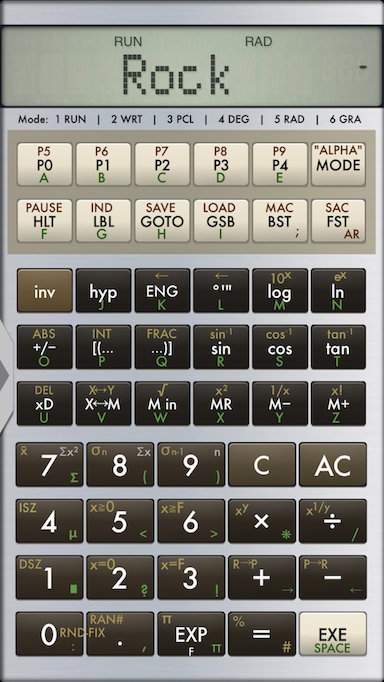

# Rock Paper Sissors

  

Here's a favorite game, played with nothing more than two friends using simple hand gesters1 representing the three objects of the game in the title. What is so fantastic about the game is its simplicity, and the lack materials needed to play. I've seen it played on road trips, summer camp, and on the playground. The challenge was always trying to predict what your opponent was going to use, to block or win that game.

The game has 3 possible outcomes, a win, draw, or loss. The win or loss is based on which item is selected2 as each item has the ability to beat, be beaten, or force a draw based on the following rules, rock crushes sissors, sissors cuts paper, and paper wraps rock, all producing a win for the player selecting the 1st item. A draw results when both players pick the same object.

  
| You | Computer | Result 
| :-:     | :-:     | :-:  
| Rock    | Rock    | Tie  
| Rock    | Paper   | I win! 
| Rock    | Sissors | You win! 
| Paper   | Rock    | You win! 
| Paper   | Paper   | Tie  
| Paper   | Sissors | I win! 
| Sissors | Rock    | I win! 
| Sissors | Paper   | You win! 
| Sissors | Sissors | Tie 

So the next time you have some time on your hands, but no one to play this game with, consider playing this against the computer in the calculator. You may be pleasantly surprised by the outcome.

Notes:

1. Start the program by pressing the P1 button. The display will flash "Rock", "Paper", "Sissors". Press P1 for Rock, P2 for Paper, or P3 for Sissors. The computer will pick one, and then compare to yours, showing the result on the screen. Afterwards, the screen will display "##:##", showing the current number of wins, yours vs. the computer. Try to see who gets to 10 first!

2. The hand gesters used to represent the items in the game are a closed fist (rock), flat hand (paper), and peace sign pointed horizontally (sissors).
  
3. An easy way to see who would win is by recalling the game title, "Rock, Paper, Sissors", and the word order. The winner will always be the player who picked the word to the right of the word selected by the other player. Using this schema, Rock would be considered to be to the right of word Sissors.
